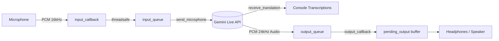

# Live Voice Translator (`livevoicetranslater.py`) - Program Logic & Architecture Analysis

[`livevoicetranslater.py`](file:///d:/code/google-gemini-examples/livevoicetranslater.py) implements a **real-time, bidirectional voice-to-voice translation** application using Google's Gemini Multimodal Live API (`gemini-3.5-live-translate-preview`) and the `sounddevice` library.

---

## 1. Core Architecture & Data Flow



---

## 2. Program Logic Breakdown

### Setup & Configuration (Lines 133–156)
* **Audio Specs:** 
  * Input (Mic): 16,000 Hz, 1-channel (mono), 16-bit PCM (`int16`).
  * Output (Headphones): 24,000 Hz, 1-channel (mono), 16-bit PCM (`int16`).
* **Live API Configuration (`types.LiveConnectConfig`):**
  * Uses `response_modalities=[types.Modality.AUDIO]`.
  * Sets `translation_config=types.TranslationConfig(target_language_code=target_language, echo_target_language=True)`.
  * Enables input and output audio transcriptions (`input_audio_transcription` and `output_audio_transcription`).
* **Client & WebSocket Session:** Connects asynchronously to Gemini's Live API endpoint via `client.aio.live.connect(model=MODEL, config=config)`.

---

### The Audio Bridge (`AudioBridge`, Lines 34–102)
Because `sounddevice` runs input/output audio callbacks on dedicated OS hardware audio threads while the rest of the application runs on the Python `asyncio` event loop, `AudioBridge` synchronizes the two environments:

* **Microphone capture (`input_callback` & `input_queue`):**
  * When the microphone receives audio blocks, `sounddevice` triggers `input_callback()`.
  * Calls `loop.call_soon_threadsafe(self.enqueue_input, bytes(indata))` to safely put the audio chunks into an `asyncio.Queue(maxsize=10)`.
* **Speaker playback (`output_callback` & `output_queue`):**
  * The speaker expects audio at strict real-time intervals.
  * An incoming thread-safe `queue.Queue(maxsize=100)` receives translated audio blocks from Gemini.
  * In `output_callback()`, chunks are drained into an internal byte buffer (`pending_output`).
  * It extracts exactly `frames * 2` bytes (16-bit = 2 bytes/sample) to fill `outdata[:]`.
  * If there isn't enough audio ready, it pads the remainder with silence (`bytes(byte_count - available)`) to avoid glitches or underflow crashes.
* **Error Propagation & Throttled Status:**
  * Contains an `asyncio.Future` (`self.error`) to propagate stream or queue errors to the main task loop.
  * Status messages (`[Microphone] Audio captured...`, `[Playback]...`) are throttled using `status_due()` (every 5 seconds) to prevent console spam.

---

### Concurrent Async Workers (Lines 104–131, Lines 182–186)
Inside an `asyncio.TaskGroup()`, two background tasks run concurrently alongside error monitoring:

1. **`send_microphone(session, audio)`**:
   * Awaits audio chunks from `audio.input_queue`.
   * Sends them as real-time audio blobs (`audio/pcm;rate=16000`) to the Gemini Live session via `session.send_realtime_input()`.
2. **`receive_translation(session, audio)`**:
   * Iterates through streaming responses via `session.receive()`.
   * **Transcriptions:** If `input_transcription` is received, prints `[Source] <text>`. If `output_transcription` is received, prints `[Translation] <text>`.
   * **Audio generation:** Extracts synthesized audio chunks from `model_turn.parts[].inline_data.data` and places them into `audio.output_queue` for playback.
3. **`await audio.error`**:
   * Watches for hardware or queue errors from the audio thread callbacks; if triggered, interrupts the task group immediately.

---

### Execution & CLI Options (Lines 188–205)
* `--target-language`: Target translation language (defaults to `es`).
* `--input-device` / `--output-device`: Specific audio device ID or names.
* `--list-devices`: Calls `sounddevice.query_devices()` to inspect available microphone and speaker hardware indices.
* Handled cleanly on `KeyboardInterrupt` (`Ctrl+C`).

---

## 3. Notable Design Decisions & Low-Level Mechanics

### Dual-Queue Strategy & Thread Boundaries

A key complexity when combining real-time audio with network I/O in Python is bridging **PortAudio C threads** and the **`asyncio` event loop**:

| Queue | Type | Producer | Consumer | Why this type? |
| :--- | :--- | :--- | :--- | :--- |
| `input_queue` | `asyncio.Queue` (max 10) | PortAudio input thread (via `call_soon_threadsafe`) | `send_microphone` async task | The async task can natively `await audio.input_queue.get()` without blocking the event loop. |
| `output_queue` | `queue.Queue` (max 100) | `receive_translation` async task | PortAudio output thread | Audio playback runs on a blocking OS audio thread; `queue.Queue.get_nowait()` is thread-safe and non-blocking for real-time audio callbacks. |

```
[PortAudio Mic Thread] 
       │ 
       ▼ loop.call_soon_threadsafe(...)
[asyncio.Queue (input_queue)] 
       │ 
       ▼ await get()
[send_microphone Task] 
       │
       ▼ session.send_realtime_input()
  [Gemini Live API]
       │
       ▼ session.receive()
[receive_translation Task]
       │
       ▼ put_nowait()
[queue.Queue (output_queue)]
       │
       ▼ get_nowait() in callback
[PortAudio Spk Thread]
```

---

### Audio Timing & Buffer Sizing Math

The constants chosen in lines 23–26 govern latency and buffer sizing:

* **Capture Interval:**
  $$\frac{\text{INPUT\_FRAMES}}{\text{INPUT\_RATE}} = \frac{1600 \text{ frames}}{16000 \text{ Hz}} = 0.1 \text{ seconds (100 ms per chunk)}$$
  * Sending 100 ms chunks strikes a balance: low enough for near-instant speech detection by the server, but not small enough to flood the network with excessive packet overhead.

* **Playback Interval:**
  $$\frac{\text{OUTPUT\_FRAMES}}{\text{OUTPUT\_RATE}} = \frac{2400 \text{ frames}}{24000 \text{ Hz}} = 0.1 \text{ seconds (100 ms per chunk)}$$
  * Both capture and playback run in synchronized 100 ms time windows.

* **Buffer Underflow Prevention (Lines 83–90):**
  ```python
  byte_count = frames * 2  # 16-bit PCM = 2 bytes per sample
  ...
  available = min(len(self.pending_output), byte_count)
  outdata[:] = self.pending_output[:available] + bytes(byte_count - available)
  ```
  If Gemini is slow to return audio or pauses between sentences, `output_callback` pads the remainder of `outdata` with zero bytes (silence). This prevents audio stutter, buzzes, or buffer-read crashes on the sound card.

---

### Graceful Lifecycle & Teardown

The resource lifecycle is managed hierarchically using standard library context managers:

```python
async with client.aio.live.connect(...) as session:    # 1. Manages WebSocket lifetime
    with contextlib.ExitStack() as streams:             # 2. Tracks hardware audio streams
        streams.enter_context(sd.RawInputStream(...))   #    - Starts & stops mic stream cleanly
        streams.enter_context(sd.RawOutputStream(...))  #    - Starts & stops headphone stream cleanly
        async with asyncio.TaskGroup() as tasks:        # 3. Manages concurrent coroutines
            tasks.create_task(...)
            await audio.error                           #    - Cancels all tasks if any error occurs
```

* **`contextlib.ExitStack`**: Guarantees audio devices close gracefully even if connection errors, queue overflow, or keyboard interrupts occur.
* **`asyncio.TaskGroup`**: If either task fails or if `audio.error` is triggered by an audio hardware glitch, `TaskGroup` immediately cancels sibling tasks and bubbles up the exception.

---

## 4. Key Components Summary

| Component | Responsibility |
| :--- | :--- |
| **`main()`** | Parses command-line flags (`--target-language`, `--input-device`, `--output-device`, `--list-devices`) and starts the async loop. |
| **`run_translation()`** | Connects to the Gemini Live session, configures translations & transcriptions, initializes microphone/headphone streams, and spawns the background worker tasks. |
| **`AudioBridge`** | Safe concurrency bridge between real-time hardware PortAudio threads and Python's `asyncio` event loop. Handles pacing, throttling status messages, padding silence, and surfacing errors. |
| **`send_microphone()`** | Pulls recorded microphone audio chunks from `input_queue` and streams them via WebSocket to Gemini. |
| **`receive_translation()`** | Listens to incoming messages from Gemini, prints source and translated transcriptions to stdout, and enqueues synthetic voice bytes for playback. |
| **`test_livevoicetranslater.py`** | Unit test suite that verifies queue pacing, padding silence on underflow, error handling, and device stream cleanup using mocks. |

---

## 5. Running & Testing

To test or run this script:

1. **Find available devices:**
   ```powershell
   python livevoicetranslater.py --list-devices
   ```
2. **Translate to another language (e.g., French, German, or Japanese):**
   ```powershell
   python livevoicetranslater.py --target-language fr
   ```
3. **Specify dedicated devices (recommended to avoid feedback loops):**
   ```powershell
   python livevoicetranslater.py --target-language es --input-device 1 --output-device 3
   ```
   > **Note:** A headset is strongly recommended over open laptop speakers to prevent the microphone from picking up the translated audio and creating an infinite translation loop.
